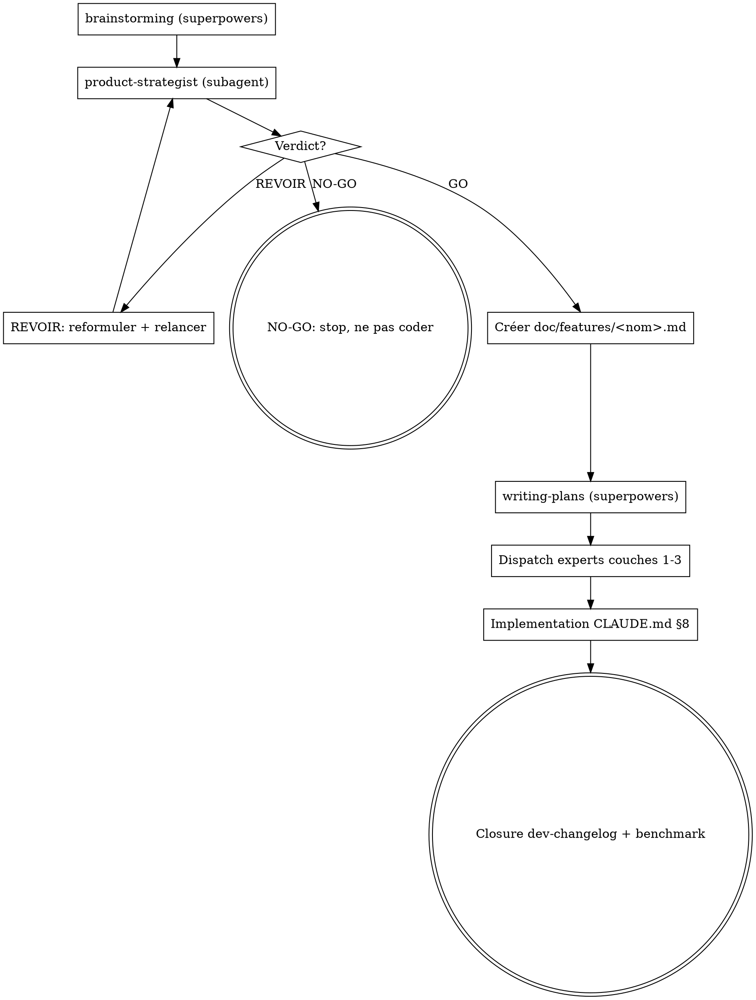

# /feature — Nouvelle feature MyProject

<HARD-GATE>
Pas une ligne de code avant : (1) verdict GO du product-strategist, (2) spec rédigée dans `docs/features/<nom>.md`, (3) plan d'implémentation validé via `writing-plans`. Cette gate est non-négociable même si l'utilisateur insiste.
</HARD-GATE>

## When to invoke

- Avant toute nouvelle feature non triviale (≥ 2 fichiers, ≥ 1 entité)
- Quand le user dit "ajoute X" / "on doit avoir X" / "et si on faisait X"
- En remplacement du step 1 du workflow CLAUDE.md §8

## When NOT to invoke

- Bugfix (corriger un comportement existant) — action directe
- Refactor pur (pas de changement UX visible) — utiliser `superpowers:brainstorming` + `writing-plans` directement
- Tâche technique sans impact user (cleanup deps, rename) — action directe

## Anti-Pattern: "Ça ressemble à du déjà-vu, c'est OK"

Tu identifies un pattern existant chez Pixieset, Honeybook, Tave → c'est exactement le signal qu'il FAUT challenger la différenciation, pas un signal de skip. Le `product-strategist` est là pour ça.

## Checklist (TaskCreate obligatoire pour chaque item)

1. **Invoquer `superpowers:brainstorming`** — collaborative design avec le user (purpose, contraintes, success criteria, 2-3 approches)
2. **Invoquer subagent `product-strategist`** avec la description issue du brainstorming — verdict strict GO/REVOIR/NO-GO
3. Si **GO** → créer `docs/features/<nom>.md` depuis `docs/feature-plan-template.md` enrichi des sorties strategic gate (Problème user, Benchmark, Différenciation, Anti-références, Conditions de GO)
4. Si **REVOIR** → proposer 2-3 reformulations au user, **ne pas coder**, relancer step 2 après reformulation acceptée
5. Si **NO-GO** → expliquer pourquoi (concurrents + anti-références), **ne pas coder**, proposer alternatives
6. **Invoquer `superpowers:writing-plans`** — générer plan d'implémentation détaillé
7. **Dispatch experts** couches 1-3 selon scope (voir `references/dispatch-matrix.md`)
8. Implémentation suit CLAUDE.md §8 step 2-6
9. **Closure** : entrée `docs/dev-changelog.md` + audit benchmark concurrent si applicable (voir `references/closure-checklist.md`)

## Process Flow



## Red Flags

| Pensée | Réalité |
|---|---|
| "C'est juste un petit ajout" | TOUT add-feature passe la gate. Cf CLAUDE.md §17.6 density gate. |
| "On a déjà un workflow pour ça" | Vérifie quand même verdict `product-strategist`. |
| "Le user est pressé, on skip strategic gate" | NO. Gate = 5 min, refonte ratée = 5 jours. |
| "C'est un copycat évident, ça vaut le coup" | Exactement le signal qu'il FAUT challenger. Cf anti-pattern ci-dessus. |
| "Le user a déjà décidé, je code" | Si verdict NO-GO, on ne code pas, même si user insiste. C'est la **valeur** du système. |

## Output format (résumé au user)

```
### Feature : <nom>

**Brainstorming** : ✅ design approuvé
**Strategic Review** : GO différentiant | REVOIR | NO-GO

[Si GO]
**Différenciation** : <one-liner vs concurrents>
**Doc créée** : `docs/features/<nom>.md`
**Plan créé** : `docs/superpowers/plans/<date>-<nom>.md`
**Experts dispatchés** : <liste>
**Prochaine étape** : implémenter selon plan + CLAUDE.md §8

[Si REVOIR]
**Reformulations proposées** :
1. <reformulation 1>
...

[Si NO-GO]
**Raison** : <concurrents + anti-références>
**Alternatives** : <suggestions>
**Décision** : on ne code pas. Reformuler et relancer `/feature` si souhaité.
```

## References

- `references/dispatch-matrix.md` — quel expert pour quel scope
- `references/closure-checklist.md` — détails phase 5 closure
- `references/strategic-gate-examples.md` — verdicts product-strategist réels passés (calibration)

## Sources

- [`docs/claude-config/experts.md`](../../docs/claude-config/experts.md) — catalogue 6 couches d'experts
- [`docs/claude-config/superpowers-integration.md`](../../docs/claude-config/superpowers-integration.md) — règle d'or routage
- `PRODUCT.md` + `docs/vision.md` — direction produit
- `docs/competitive-benchmark/` — fiches 13 concurrents
- `docs/feature-plan-template.md` — template doc feature
- `CLAUDE.md` §8 (workflow) + §17 (discipline agentic)
